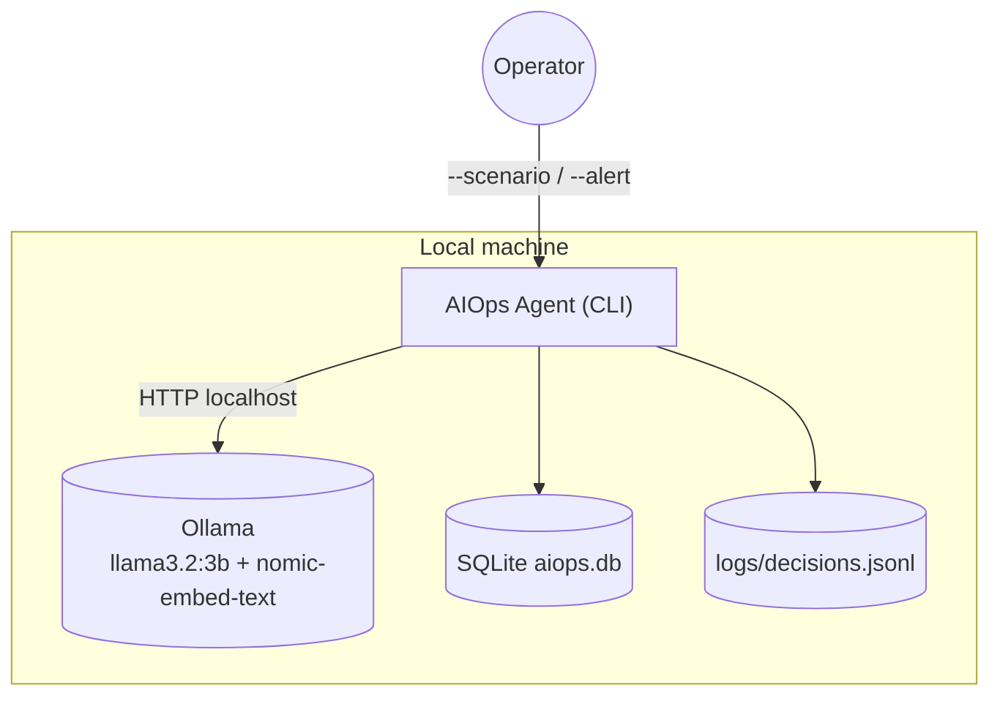
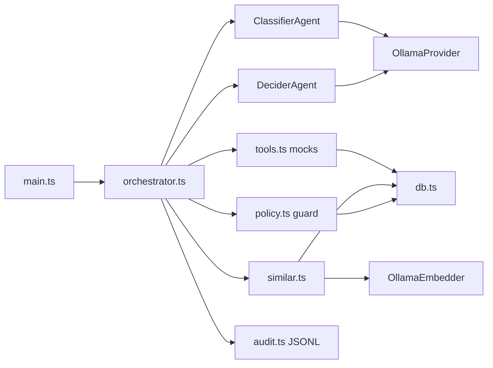
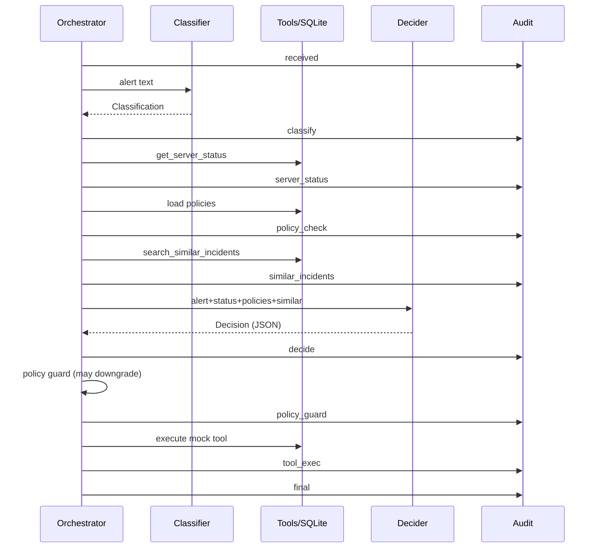
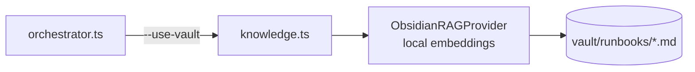

# Design Document — AIOps Agent (CHEW-style white-box)

> **Status**: Draft  
> **Last Updated**: 2026-10-19  
> **Version**: 0.1.0

---

## 1. System Overview

Lightweight "white-box" system that receives alerts/tickets, processes them locally with a small LLM (Ollama, CPU-only), picks one action from a closed catalog and records an auditable, structured explanation. Built on `@backendkit-labs/agent-core` (tools, provider contracts) with a minimal in-repo orchestrator.

### 1.1 Purpose
Show that autonomous AIOps decisions can be cheap, local, deterministic where it matters (policy, execution) and fully traceable.

### 1.2 Stakeholders
- **Operators/SRE**: review decisions and approvals.
- **Auditors**: read JSONL to reconstruct why an action was chosen.
- **Developers**: extend scenarios, tools and policies.

### 1.3 Non-goals
Real remediation, cloud services, GPUs, chain-of-thought exposure.

---

## 2. Architecture (C4 Level 1)



No outbound internet. Only localhost Ollama.

---

## 3. Component Diagram (C4 Level 2)



---

## 4. Technology Stack

| Concern | Choice | Reason |
|---------|--------|--------|
| Language | TypeScript (Node >=20) | Framework is TS |
| Agent framework | `@backendkit-labs/agent-core` (`defineTool`, `LLMProvider`, `ToolDefinition`) | Mandated; typed tools |
| LLM | `OllamaProvider` from `@backendkit-labs/agent-coding` | Existing local provider |
| Embeddings | `OllamaEmbedder` from `@backendkit-labs/agent-enterprise` | Existing, nomic-embed-text |
| Resilience | `@backendkit-labs/retry` | Preferred lib (global rule) |
| Storage | `better-sqlite3` | Already used in repo; sync, fast |
| Validation | zod (framework instance) | Closed enums, schemas |
| Tests | jest + ts-jest | Repo convention |

---

## 5. Key Architectural Decisions

| # | Decision | Rationale |
|---|----------|-----------|
| D1 | Own lightweight orchestrator, not core `Orchestrator`/FSM | Core FSM is coding-workflow oriented; customGates overkill for a linear 9-step flow with 2 agents. Revisit if verticals multiply. |
| D2 | LLM returns JSON only; orchestrator executes tools | Model cannot invent commands/tools; execution surface is code-controlled |
| D3 | Policy guard is deterministic code after the LLM | Policy cannot be bypassed by prompt/model error |
| D4 | `justification` = 3–5 evidence bullets, no CoT | White-box without exposing private reasoning |
| D5 | Vectors stored in SQLite BLOB, cosine in memory | No FAISS/Chroma dependency; <30 ms at MVP scale (hundreds of incidents) |
| D6 | One JSONL event per step, uniform schema with nulls | Greppable, diffable, jq-friendly |
| D7 | Providers/embedder injectable | Deterministic tests without Ollama |

---

## 6. Data Flow — Alert → Decision



---

## 7. Similar-Incident Search

1. Seed: embed `title + text` of each incident at first run (cached in `incidents.embedding`).
2. Query: embed alert summary (timed separately: `embed_ms`).
3. Search: load vectors, cosine, top-k (timed: `search_ms`, target <30 ms).
4. Fallback if Ollama embed unavailable: token-overlap scoring, `method:"keyword"` in evidence.

Reported in console and in the `similar_incidents` event (`latency_ms`).

---

## 7b. Knowledge Lookup (optional vault)



- Uses `ObsidianRAGProvider` as a library (no MCP stdio process); dedicated vault, separate from the repo's codex-context vault.
- Curation without external LLM: hand-written notes + local reindex. Optional Ollama-based curation for raw docs, reviewed manually.
- Advisory only: feeds `evidence` and decider context, never the policy guard. Latency (seconds) is reported separately from the <30 ms incident search.
- Embeddings via local Ollama (`nomic-embed-text`, same `OllamaEmbedder` as incident search); no network use beyond localhost. Model obtained once with `ollama pull nomic-embed-text` (~274 MB).
- See ADR-010.

---

## 8. Project Structure

```
agents/aiops-agent/
├── package.json  tsconfig.json  jest.config.js
├── specification.md design.md security.md roadmap.md README.md
├── src/
│   ├── main.ts          CLI (--scenario, --alert)
│   ├── config.ts        env: OLLAMA_BASE_URL, MODEL_NAME, EMBED_MODEL, DB_PATH, LOG_PATH
│   ├── types.ts         zod schemas + ActionEnum
│   ├── scenarios.ts     cpu_99 + extras
│   ├── db.ts            schema + idempotent seed
│   ├── tools.ts         typed mock tools
│   ├── similar.ts       embeddings + cosine search
│   ├── knowledge.ts     optional vault lookup (ADR-010)
│   ├── policy.ts        deterministic guard
│   ├── prompts.ts       classifier/decider prompts
│   ├── agents.ts        ClassifierAgent, DeciderAgent
│   ├── orchestrator.ts  flow + audit
│   └── audit.ts         JSONL writer (spec's logging_utils)
├── tests/               cpu99, guard, mocks, similarity
├── vault/               runbooks/*.md (hand-written notes, optional)
├── data/                aiops.db (gitignored)
└── logs/                decisions.jsonl (gitignored)
```

---

## 9. Resilience

Ollama calls: timeout + retry (`@backendkit-labs/retry`, exponential backoff, max 2). No circuit breaker (single local dependency). Failure mode is explicit `needs_human`, never a guessed action.

## 10. Deployment

Local CLI only: `ollama serve`, `ollama pull llama3.2:3b nomic-embed-text`, `npm start -- --scenario cpu_99`. CPU-only; 3B model ≈ 2 GB RAM.

## 11. Performance

Targets: similarity search <30 ms; end-to-end dominated by 2 LLM calls (seconds on CPU). Temperature 0, `max_tokens` capped (~400) to bound latency.
